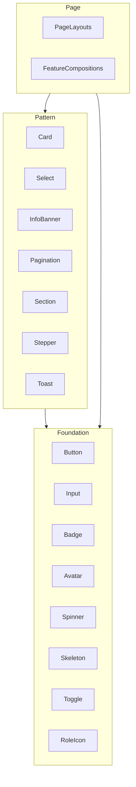
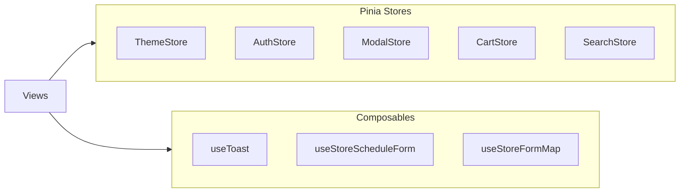

# Synti-IQ Frontend Conventions

Canonical reference for component architecture, design system usage, Storybook, state management, and naming conventions in the Synti-IQ web application.

---

## Table of Contents

- [Audit Summary](#audit-summary)
- [Component Architecture](#component-architecture)
  - [Pages & Views](#pages--views)
  - [Loading, Error & Empty States](#loading-error--empty-states)
- [Tailwind Design System](#tailwind-design-system)
- [Storybook Standards](#storybook-standards)
- [State Management & Logic](#state-management--logic)
  - [Reactivity Primitives](#reactivity-primitives)
- [Forms and Validation](#forms-and-validation)
- [Routing](#routing)
- [Prop & Event Naming](#prop--event-naming)
- [File Structure and Script Conventions](#file-structure-and-script-conventions)
  - [Directives](#directives)
- [Testing](#testing)
- [Quick Reference](#quick-reference)

---

## Audit Summary

_(Snapshot — update when UI module changes significantly.)_

The current `src/modules/ui/` module (as of audit) contains:

| Category              | Count      | Notes                                                                                                        |
| --------------------- | ---------- | ------------------------------------------------------------------------------------------------------------ |
| Foundation components | 11         | Button, Input, Textarea, Badge, Avatar, Spinner, Skeleton, Toggle, RoleIcon, Autocomplete, TokenAutocomplete |
| Pattern components    | 9          | Card, Select, Toast, ToastProvider, Pagination, Section, SectionSkeleton, InfoBanner, Stepper                |
| Design tokens         | 5 TS + CSS | `tokens/colors.ts`, `spacing.ts`, `typography.ts`, `shadows.ts`, `index.ts`; `styles/tokens.css`             |
| Composables           | 1          | useToast                                                                                                     |
| Styles                | 2 files    | `styles/base.css` (e.g. `.sr-only`, focus-visible), `styles/tokens.css`                                      |

**Barrel exports:** See [`src/modules/ui/components/index.ts`](../src/modules/ui/components/index.ts) for the authoritative list.

**ConfirmModal / StatusModal:** Stories for confirmation and status modals live next to the **implementations** in `src/modules/shared/components/` (see [Storybook cleanup](#storybook-and-cross-module-stories) below). They are not exported from `@/modules/ui`.

**Current Patterns:**

- Mix of Options API + external `.ts` (Button, Input, Card, and most foundation/pattern components) and `<script setup>` (e.g. InfoBanner, Section, TokenAutocomplete, Toast, ToastProvider, SectionSkeleton)
- Utility-first Tailwind with computed class arrays; some arbitrary values (e.g. touch targets `min-h-[44px]` in Pagination) — prefer tokens or documented a11y exceptions
- Storybook with autodocs, `@storybook/addon-a11y`, light/dark toolbar, Pinia decorator; viewports in `preview.ts`
- Teleport used for Toast; modals in shared/checkoutBox

**Latest audit:** [docs/audits/frontend-ui-audit-2026-03-25.md](audits/frontend-ui-audit-2026-03-25.md)

**Gaps Identified:**

| Gap                         | Recommendation                                                                                                                                                                                                             |
| --------------------------- | -------------------------------------------------------------------------------------------------------------------------------------------------------------------------------------------------------------------------- |
| Magic numbers in templates  | Replace `text-[13px]` with `text-sm`; use design scale only                                                                                                                                                                |
| Arbitrary Tailwind in `ui/` | **Addressed:** touch targets use `min-h-11 min-w-11`; toast uses `min-w-toast max-w-toastViewport` (`tailwind.config.js` + `tokens.css`); TokenAutocomplete uses `min-w-28`, `min-h-11`, `max-w-48`. See `tokens/a11y.ts`. |
| Inconsistent script style   | Standardize on `<script setup>` for new components                                                                                                                                                                         |
| Tailwind config vs tokens   | Ensure `theme.extend` uses full token scale from `tokens/*.ts`                                                                                                                                                             |
| Storybook viewports         | Configured in preview.ts; no addon needed                                                                                                                                                                                  |
| Button `children` prop      | Document as Storybook-only pattern (not a Vue prop)                                                                                                                                                                        |
| ToastProvider story         | **Done:** `ToastProvider.stories.ts` (Provider + slot + `useToast`)                                                                                                                                                        |

### Storybook and cross-module stories

- UI primitives belong under `src/modules/ui/components/<Name>/` with `<Name>.vue` + `<Name>.stories.ts`.
- **Do not** add Storybook-only folders under `ui/components/` that only re-export shared components. Prefer `*.stories.ts` colocated with the real component (e.g. `shared/components/ConfirmModal/ConfirmModal.stories.ts`).

---

## Component Architecture

### Foundation / Pattern / Page Taxonomy

We use an adapted Atomic Design hierarchy for clarity and scalability:



| Tier           | Purpose                                            | Examples                                                          |
| -------------- | -------------------------------------------------- | ----------------------------------------------------------------- |
| **Foundation** | Single-purpose, no domain logic, highly reusable   | Button, Input, Badge, Avatar, Spinner, Skeleton, Toggle, RoleIcon |
| **Pattern**    | Composed from Foundation; reusable across features | Card, Select, InfoBanner, Pagination, Section, Stepper, Toast     |
| **Page**       | Full page layouts or feature-specific compositions | SalesView, Profile, StoreDetails                                  |

### Pages & Views

- Place in `src/modules/<feature>/pages/`
- Use `PageName.vue` + `PageName.ts` (logic) or `<script setup>` only
- Register route in module router (e.g. `profileRoutes.ts`)
- Use PageLayout if available

### Creating a New Page

1. Create `PageName.vue` and optionally `PageName.ts` in `src/modules/<feature>/pages/`.
2. Add the route in `src/modules/<feature>/router/<feature>Routes.ts`.
3. Import the feature router in the main router and ensure the route is registered.
4. Use `route.meta.requiresAuth` and `route.meta.roles` for guards.

**Examples:** SalesView, Profile, StoreDetails

### New Page with script setup (recommended)

For new pages, use `<script setup lang="ts">` with a composable:

1. Create `PageName.vue` with:

```vue
<script setup lang="ts">
import { usePageName } from './composables/usePageName';
const { ... } = usePageName();
</script>
<template>...</template>
```

2. Create `composables/usePageName.ts` for page logic.
3. Register route in `src/modules/<feature>/router/<feature>Routes.ts`; use lazy loading for heavy pages.
4. Use `route.meta.requiresAuth` and `route.meta.roles` for guards.

Existing pages (Profile, SalesView, StoreDetails) use Options API; use them as structure reference only, not as template.

### Directory Layout

```
src/modules/ui/components/
├── foundation/          # Optional: group Foundation components
│   ├── Button/
│   ├── Input/
│   └── ...
├── pattern/             # Optional: group Pattern components
│   ├── Card/
│   ├── Section/
│   └── ...
```

For simplicity, a flat `components/` folder is acceptable; the tier is conceptual. New components should be placed in `ComponentName/` with the standard file set.

### Stepper (Wizard Flows)

Use the canonical `Stepper` component from `@/modules/ui/components` for multi-step flows (wizards). **Do not build custom step indicators**; homologate with the UI Stepper.

| Prop         | Type            | Description                                 |
| ------------ | --------------- | ------------------------------------------- |
| `modelValue` | `number`        | Current step (1-based). Use `v-model`.      |
| `steps`      | `StepperStep[]` | Array of `{ id, title, shortTitle, icon }`. |
| `dark`       | `boolean`       | Dark theme colors.                          |
| `animated`   | `boolean`       | Enter animations and active-step glow.      |

**Reference implementations:**

- [StoreForm.vue](../src/modules/store/pages/StoreForm/StoreForm.vue) — Store creation wizard
- [TwoFactorSetupModal.vue](../src/modules/profile/components/TwoFactorAuth/TwoFactorSetupModal.vue) — 2FA activation wizard

**Example:**

```vue
<Stepper v-model="currentStep" :steps="wizardSteps" :dark="isDark" :animated="true" />
```

```ts
const WIZARD_STEPS: StepperStep[] = [
  { id: 1, title: 'Basic information', shortTitle: 'Data', icon: 'info-circle' },
  { id: 2, title: 'Location', shortTitle: 'Location', icon: 'map-marker-alt' },
  { id: 3, title: 'Opening hours', shortTitle: 'Hours', icon: 'clock' },
];
```

### Slots

| Scenario               | Slot usage                                           |
| ---------------------- | ---------------------------------------------------- |
| Body content           | `default`                                            |
| Header/footer          | `header`, `footer`                                   |
| Custom icon/actions    | Named slots: `icon`, `actions`                       |
| Composition over props | Prefer slots over prop drilling for flexible content |

**Examples:**

- Card: `header`, default, `footer`
- InfoBanner: `icon`, default, `actions`
- Section: `header`, default, `footer` (via Card)

### Teleport

Use `Teleport to="body"` for:

- Modals and dialogs
- Toasts and notifications
- Overlays that must escape parent overflow/stacking context

**Requirements:**

- Ensure proper z-index: use `z-50` for overlays (modals, toasts); `z-[100]` only when stacking above other overlays
- Manage focus and accessibility (focus trap, aria-modal)
- Clean up on unmount

**References:** `Toast.vue`, `ConfirmModal.vue`, `CashClosingModal.vue`

### Async Components

For route-level or heavy components, use `defineAsyncComponent` for code-splitting and lazy-loading:

```typescript
import { defineAsyncComponent } from 'vue';

const HeavyChart = defineAsyncComponent(() => import('./HeavyChart.vue'));
```

Use for:

- Lazy-loaded routes
- Heavy components not needed on initial load
- Components with large dependencies

### Loading, Error & Empty States

Handle these states consistently in list, feed, and data-driven components:

- **Loading:** Use Spinner or Skeleton components. Prefer a composable for `loading` state.
- **Error:** Use InfoBanner `variant="error"` with a retry action. Expose `error` in the composable or store.
- **Empty:** Provide an empty-state slot or message (e.g. "No items yet"). Avoid blank screens.

**References:** Spinner, Skeleton, InfoBanner

### Transitions and Animations

- Use `@vueuse/motion` (v-motion) for enter/leave and orchestrated animations.
- Use Vue `<Transition>` / `<TransitionGroup>` for simple CSS transitions.
- Prefer design tokens for duration (e.g. `duration-200`, `duration-300`).

---

## Tailwind Design System

### No Magic Numbers

**Prohibited:** Hardcoded values not in the design scale. For typography: `text-[13px]` is prohibited; use `text-sm` (0.875rem ≈ 14px) for small secondary text. Tailwind's default scale includes fractional values (0.5, 1.5, 2.5, etc.); `mt-0.5`, `gap-1.5` are valid.

```html
<!-- Bad -->
<div class="px-7 text-[13px] gap-3.5 mt-[17px]">...</div>

<!-- Good -->
<div class="px-4 text-sm gap-3 mt-4">...</div>
```

### Design Scale

| Token          | Source                                   | Usage                                                       |
| -------------- | ---------------------------------------- | ----------------------------------------------------------- |
| **Spacing**    | `tokens/spacing.ts`, `tokens.css`        | `p-4`, `gap-2`, `mt-6` (0, 1–6, 8, 10–12, 16, 20–24, 32–96) |
| **Colors**     | `tokens/colors.ts`, `tailwind.config.js` | `bg-primary`, `text-success`, `border-gray-200`             |
| **Typography** | `tokens/typography.ts`, `tokens.css`     | `text-sm`, `font-medium`, `leading-normal`                  |
| **Shadows**    | `tokens/shadows.ts`                      | `shadow-md`, `shadow-lg`                                    |

Semantic colors: `primary`, `success`, `warning`, `error`, `info` plus `gray-*` scale. Dark mode via `dark:` variants.

### @apply vs Utility Classes

| Approach            | When to use                                                                                                                                                                                    |
| ------------------- | ---------------------------------------------------------------------------------------------------------------------------------------------------------------------------------------------- |
| **Utility classes** | Default. Use in templates for all styling.                                                                                                                                                     |
| **@apply**          | Only when: (1) overriding third-party library styles; (2) extracting a repeated pattern that appears 3+ times in the same component and improves readability. Document rationale in a comment. |

```vue
<!-- Preferred: utilities in template -->
<button class="inline-flex items-center justify-center font-medium rounded-lg px-4 py-2">

<!-- @apply only when justified -->
<style scoped>
.overrides-external-widget {
  @apply rounded-lg border border-gray-200 p-4;
}
</style>
```

### Tailwind Config Sync

- `tailwind.config.js` may be legacy; Tailwind v4 uses a CSS-first `@theme` approach. Keep `src/modules/ui/tokens/*.ts` and `src/modules/ui/styles/tokens.css` as the source of truth.
- If using the JS config, extend `theme` with values from `src/modules/ui/tokens/*.ts`. `tokens.css` and config must stay in sync.

### Tailwind v4 Note

Tailwind v4 uses a CSS-first approach with `@theme` directive and design tokens as CSS variables. Migration from the current JS config is a follow-up task; this document applies to both approaches.

---

## Storybook Standards

### Meta Configuration

```typescript
const meta: Meta<typeof Component> = {
  title: 'UI/ComponentName',
  component: Component,
  tags: ['autodocs'],
  argTypes: {
    /* ... */
  },
  parameters: {
    docs: {
      description: {
        component: 'One-line description of the component.',
      },
    },
  },
};
```

### Args and ArgTypes

- All interactive props as `args`
- Use `args.children` for default slot content in story templates. This is a **Storybook-only convention** (not a Vue prop); the component receives it via the default slot in the render template.
- Explicit `control` and `description` for each prop
- Use `control: 'select'` with `options` for union types

### Parameters

| Parameter     | Value                 | When                             |
| ------------- | --------------------- | -------------------------------- |
| `layout`      | `'centered'`          | Default                          |
| `layout`      | `'fullscreen'`        | Modals, overlays                 |
| `backgrounds` | light/dark            | Use toolbar (already in preview) |
| `viewport`    | mobile/tablet/desktop | Responsive stories               |

### Event Logging

```typescript
argTypes: {
  onClick: { action: 'clicked' },
  onClose: { action: 'closed' },
}
```

### Interaction Testing (play)

For components with user interactions, add a `play` function to verify behavior:

```typescript
import { within, userEvent } from '@storybook/test';

export const Interactive: Story = {
  play: async ({ canvasElement }) => {
    const canvas = within(canvasElement);
    await userEvent.click(canvas.getByRole('button'));
  },
};
```

Use `play` when:

- The component has clickable elements or forms
- You want to verify interaction flows
- Testing accessibility (e.g. focus, aria)

### When a Component Needs a Story

| Question                                                                  | Answer | Action                                        |
| ------------------------------------------------------------------------- | ------ | --------------------------------------------- |
| Is it a Foundation or Pattern component (Button, Card, InfoBanner, etc.)? | Yes    | Story **required**                            |
| Is it a page-level composition used only in one route?                    | Yes    | Story optional (useful for visual regression) |
| Is it a layout wrapper with no visual variants?                           | Yes    | Story optional                                |
| Is it a form field, modal, or reusable UI piece?                          | Yes    | Story **required**                            |

**Rule:** Every UI component in `src/modules/ui/` must have a `.stories.ts` file. Feature-specific components that are reused should have stories; one-off page compositions may skip.

### Story Types

Each component should have:

- **Default**: Base case
- **Variants**: One story per variant (Primary, Secondary, etc.)
- **Sizes**: All size options (when the component has size prop)
- **States**: Add Loading, Disabled, Error stories only when the component has loading, disabled, or error props
- **AllVariants**: Visual regression / design review

### Viewport

Viewport is configured in `.storybook/preview.ts` (mobile 320px, tablet 768px, desktop 1024px). No separate addon is required for Storybook 10. Use the viewport toolbar to test responsive stories.

### Manual accessibility review (Storybook)

Use this checklist when touching UI or before a release candidate (complements automated lint; does not replace manual keyboard and screen reader tests):

1. Open Storybook, enable the **Accessibility** toolbar (`@storybook/addon-a11y`).
2. For each story under `UI/*` (and shared stories that ship UI), confirm **no critical violations** or document exceptions in the PR.
3. Switch **viewport** (mobile / tablet / desktop) and ensure layout and focus order remain usable.
4. For interactive components: tab with keyboard, activate with Enter/Space, and verify focus traps for modals/overlays where applicable.

---

## State Management & Logic

### Pinia vs Composables



### Decision Matrix

| Use case                          | Use                         | Example                                   |
| --------------------------------- | --------------------------- | ----------------------------------------- |
| Theme, auth, modal visibility     | Pinia                       | ThemeStore, AuthStore, useModalStore      |
| Form logic, API fetch, validation | Composable                  | useStoreScheduleForm, useStoreFormPayload |
| Search state shared in module     | Pinia                       | useSearchStore                            |
| Single-page form/component logic  | Composable                  | useStoreDetailsPage                       |
| Toast notifications (singleton)   | Composable + optional store | useToast                                  |

### API in Stores

Stores that fetch data should expose: `items` (or equivalent), `loading`, `error`. Use async actions:

1. Set `loading = true` before the fetch
2. On success: set data, clear `error` and `loading`
3. On error: set `error`, clear `loading`

**References:** authStore, useSearchStore

### Decision Tree

Use this flow to choose where state belongs:

```
Is the state shared across 2+ pages or routes?
  YES → Pinia (useXxxStore)

Does the logic need cleanup on unmount (e.g. watchers, subscriptions)?
  YES → Composable (useXxx)

Is it a singleton (toast, modal) shared globally?
  YES → Composable + optional store (useToast)

Otherwise (single component, no persistence) → ref() or reactive() in the component
```

| Question                       | Answer | Use                           |
| ------------------------------ | ------ | ----------------------------- |
| Cross-route or shared globally | Yes    | Pinia                         |
| Page/feature logic, cleanup    | Yes    | Composable                    |
| Singleton (toast, modal)       | Yes    | Composable + optional store   |
| Single component only          | Yes    | `ref()` or `reactive()` local |

### Rule

Keep business logic in composables; views only bind state and call methods. Pinia stores hold cross-route or global UI state.

**References:** ThemeStore, useToast, useStoreScheduleForm

### Reactivity Primitives

Choose the right primitive for the job:

| Use case                            | Primitive        | When                                                                        |
| ----------------------------------- | ---------------- | --------------------------------------------------------------------------- |
| Theme, config, dependency injection | `provide/inject` | Cross-component context without prop drilling; type with `InjectionKey<T>`. |
| Derived state from existing refs    | `computed`       | Synchronous transformation; cached.                                         |
| Side effects when props/refs change | `watch`          | Explicit dependencies; run logic when specific values change.               |
| Side effects with implicit deps     | `watchEffect`    | Dependencies inferred from usage; prefer `watch` when deps are clear.       |

- **storeToRefs:** Use when destructuring Pinia store state in components. Preserves reactivity.
- **toRefs:** Use for plain reactive objects (e.g. props destructuring). Do NOT use for Pinia stores.

**Reference:** [useStoreScheduleForm](../src/modules/store/composables/useStoreScheduleForm.ts) for form logic and validation patterns.

### Creating a Composable

1. **File:** Place in `src/modules/<feature>/composables/useXxx.ts`.
2. **Naming:** Use `useXxx` (camelCase after "use").
3. **Return:** Export a function that returns a typed object. Avoid returning raw refs; group in an object.
4. **Single responsibility:** One composable, one concern. Split when logic grows.
5. **References:** [useGreeting](../src/modules/home/composables/useGreeting.ts), [useStoreScheduleForm](../src/modules/store/composables/useStoreScheduleForm.ts).

### Creating a Pinia Store

1. **File:** Place in `src/modules/<feature>/stores/useXxxStore.ts`. Exception: module-scoped stores (e.g. search within checkoutBox) may live in `composables/useXxxStore.ts` if the team prefers colocation; document the choice in the module README.
2. **Naming:** Use `useXxxStore` (camelCase; "Store" suffix).
3. **Structure:** `defineStore('unique-id', { state, getters, actions })`.
4. **Async actions:** Set `loading = true` before fetch; on success set data and clear `error`/`loading`; on error set `error` and clear `loading`.
5. **References:** [authStore](../src/modules/auth/stores/authStore.ts) (standard location), [useSearchStore](../src/modules/checkoutBox/composables/useSearchStore.ts) (module-scoped, composables for colocation).

**Store reset:** For logout or test teardown, use `store.$reset()` (Pinia built-in) or define a custom reset action that clears state to initial values.

---

## Forms and Validation

- **Binding:** Use `v-model` with `defineModel()` (Vue 3.4+) or `modelValue` / `update:modelValue` for form fields. With **VeeValidate**, prefer `<Field name="path.to.field" v-slot="{ componentField, errorMessage }">` and `v-bind="componentField"` on [Input](../src/modules/ui/components/Input/Input.vue) / [Select](../src/modules/ui/components/Select/Select.vue) / [Textarea](../src/modules/ui/components/Textarea/Textarea.vue), plus `:error` / `:error-message` from the slot.
- **Logic:** Keep validation and submit logic in a composable (e.g. `useXxxForm`); bind in the view.
- **Validation:** **Zod** is the source of typed rules; use `@vee-validate/zod` `toTypedSchema()` with VeeValidate `useForm()`. Global defaults: [vee-validate.config.ts](../src/modules/forms/vee-validate.config.ts) (`setupVeeValidate()` from [main.ts](../src/main.ts)). Validate on explicit actions (Next/submit) unless a screen needs live feedback.
- **References:**
  - [useStoreForm](../src/modules/store/composables/useStoreForm.ts) — canonical **multi-step wizard**: `useForm` + Zod schema, step-scoped `validateField`, opening hours still via [useStoreScheduleForm](../src/modules/store/composables/useStoreScheduleForm.ts); pairs with [StoreForm.vue](../src/modules/store/pages/StoreForm/StoreForm.vue).
  - [store-wizard.schema.ts](../src/modules/store/schemas/store-wizard.schema.ts) — Zod schema and step field path constants for the store wizard (pilot).
  - [useStoreScheduleForm](../src/modules/store/composables/useStoreScheduleForm.ts) — schedule rows, validation, and apply-to-days (opening hours sub-form).

---

## Routing

Routes live in `src/modules/<feature>/router/<feature>Routes.ts` (e.g. `profileRoutes.ts`). Import the module router in the main router. Use `route.meta` for guards (e.g. `requiresAuth`, `roles`). Register new routes in the feature router and ensure the main router includes the module.

### Adding a New Route

1. Register in `src/modules/<feature>/router/<feature>Routes.ts`.
2. Set `route.meta.requiresAuth` and `route.meta.roles` as needed for guards.
3. Use lazy loading for heavy pages: `component: () => import('./pages/PageName.vue')`.

---

## Prop & Event Naming

### Booleans

Prefix with `is*` or `has*`:

```typescript
(isDisabled, isLoading, hasError, fullWidth, dismissable);
```

### Event Props (Callbacks)

Use `on*` when passing callback props:

```typescript
onClick?: () => void;
onClose?: () => void;
onSubmit?: (payload: FormData) => void;
```

### Internal Handlers

Use `handle*` for internal event handlers:

```typescript
const handleClick = () => emit('click');
const handleDismiss = () => emit('remove');
```

### v-model

- Prop: `modelValue`
- Event: `update:modelValue`
- Or use `defineModel()` (Vue 3.4+)

### Template Usage

Use kebab-case in templates:

```html
<button :is-loading="loading" @update:model-value="value = $event" />
```

### Slot Names

Semantic names: `default`, `header`, `footer`, `icon`, `actions`

---

## File Structure and Script Conventions

### Standard Layout

```
ComponentName/
├── ComponentName.vue    # Template and optional script
├── ComponentName.ts     # Logic (if using Options API or shared logic)
└── ComponentName.stories.ts
```

### Creating a Component (End-to-End)

See also: [AGENTS.md](../AGENTS.md) — Creating a Component (Quick Flow).

1. **Define types:** Props and Emits interfaces (in `.vue` or shared types file).
2. **Component:** Create `ComponentName.vue` with `<script setup lang="ts">`, `defineProps<Props>()`, `defineEmits<...>()`.
3. **Stories:** Create `ComponentName.stories.ts` with Default, Variants, States (Loading, Disabled, Error).
4. **Export:** Add to `src/modules/ui/components/index.ts` barrel if it is a UI component.
5. **Optional:** Add unit spec for composable logic or complex behavior.

### Script Preference

- **New components:** ALWAYS use `<script setup lang="ts">`. No Options API or `defineComponent`.
- **Existing legacy components (Button, Card, Input):** May use Options API + external `.ts`; do not use as templates for new components.
- Export types from component file; re-export from barrel.

**ESLint:** `vue/component-api-style` enforces `<script setup>` and currently runs as `warn` during legacy migration. It will be upgraded to `error` after Button, Card, and Input migrate to Composition API. `vue/no-v-html` is `warn` (XSS prevention).

### Legacy component migration (optional, incremental)

High-traffic primitives (Button, Card, Input, Textarea, Select, etc.) may still use Options API + `*.ts`. **Do not** rewrite them in one pass. When a file needs substantive changes:

1. Prefer migrating that file to `<script setup lang="ts">` following [InfoBanner](../src/modules/ui/components/InfoBanner/) or [Section](../src/modules/ui/components/Section/).
2. Keep public props/emits and class names stable unless the change is intentional.
3. After the main legacy set is migrated, tighten ESLint: set `vue/component-api-style` to `error` in `eslint.config.mjs`.

### ESLint Rules (Enforced)

| Rule                                 | Level | Purpose                                                                  |
| ------------------------------------ | ----- | ------------------------------------------------------------------------ |
| `@typescript-eslint/no-explicit-any` | error | No `any`; use concrete types or `Record<string, unknown>`                |
| `@typescript-eslint/no-unused-vars`  | error | No unused variables; use `_` prefix for intentionally unused params      |
| `vue/component-api-style`            | warn  | Enforces `<script setup>`; will become error after legacy migration      |
| `vue/no-v-html`                      | warn  | XSS prevention; discourage unless justified                              |
| `vue/define-macros-order`            | warn  | Order: defineOptions, defineProps, defineEmits, defineSlots, defineModel |
| `vue/block-order`                    | warn  | Order: script, template, style                                           |
| `vue/multi-word-component-names`     | warn  | Avoid single-word component names                                        |

### Barrel Export

```typescript
// src/modules/ui/components/index.ts
export { default as Button } from './Button/Button.vue';
export type { ButtonProps } from './Button/Button.ts';
```

### Directives

- Place in `src/modules/<feature>/directives/` or `src/shared/directives/`.
- Use `app.directive('vDirectiveName', { mounted, updated, unmounted })` or object with lifecycle hooks.
- Prefer composable for reusable logic; directive when DOM binding is required (e.g. v-focus, v-click-outside).
- Reference: [Vue 3 custom directives](https://vuejs.org/guide/reusability/custom-directives.html).

---

## Testing

- **Framework:** Vitest. Run with `yarn test` or `yarn test:coverage`.
- **Coverage:** Run `yarn test:coverage` before PR. No enforced minimum yet; aim for 80% on new composables and stores.
- **Pinia stores:** Call `setActivePinia(createPinia())` in `beforeEach` so each test gets a fresh store instance.
- **Composables:** Use `createApp` + `defineComponent` or `@vue/test-utils` `mount`. Prefer `mount` for integration tests.
- **Reference:** [tests/home/composables/useGreeting.spec.ts](../tests/home/composables/useGreeting.spec.ts) for composable testing; [tests/auth/stores/authStore.spec.ts](../tests/auth/stores/authStore.spec.ts) for store testing. When the auth layer changes (e.g. token storage, API shape), update mocks in the store spec to match.

### Test File Location

Place spec files in one of two ways:

- **Colocated:** `ComponentName.spec.ts` or `useXxx.spec.ts` next to the source file.
- **Feature tests:** `tests/<feature>/composables/` and `tests/<feature>/stores/` (e.g. `tests/home/composables/useGreeting.spec.ts`, `tests/auth/stores/authStore.spec.ts`).

See [docs/prompts/write-spec.md](prompts/write-spec.md) for step-by-step guidance.

### Component Tests

- Use `@vue/test-utils` `mount()` for integration tests; prefer over `shallowMount`.
- Use `shallowMount()` only when child components cause side effects (API calls, complex DOM) that block the test.
- Prefer `mount()` unless the test is slow or flaky.
- If the component uses Pinia: `setActivePinia(createPinia())` in `beforeEach` so each test gets a fresh store.
- Example pattern:

```typescript
import { mount } from '@vue/test-utils';
import { setActivePinia, createPinia } from 'pinia';
import MyComponent from './MyComponent.vue';

describe('MyComponent', () => {
  beforeEach(() => {
    setActivePinia(createPinia());
  });

  it('renders and responds to user input', () => {
    const wrapper = mount(MyComponent, { props: { label: 'Test' } });
    expect(wrapper.text()).toContain('Test');
  });
});
```

---

## Quick Reference

### Responsive JS vs Tailwind breakpoints

When `matchMedia` or `useMediaQuery` must align with Tailwind’s `md` (768px), import **`MEDIA_BELOW_MD`** from [`src/modules/shared/constants/viewport-media.ts`](../src/modules/shared/constants/viewport-media.ts) instead of duplicating pixel strings.

### Design Tokens

| Token       | Keys                                          | Example classes               |
| ----------- | --------------------------------------------- | ----------------------------- |
| Spacing     | 0, 1–6, 8, 10–12, 16, 20–24, 32–96            | `p-4`, `gap-2`, `mt-6`        |
| Colors      | primary, success, warning, error, gray-50–950 | `bg-primary`, `text-gray-700` |
| Font size   | xs, sm, base, lg, xl, 2xl–9xl                 | `text-sm`, `text-lg`          |
| Font weight | thin–black                                    | `font-medium`, `font-bold`    |
| Shadows     | none, sm, base, md, lg, xl, 2xl, inner        | `shadow-md`                   |

### Component Tiers

| Tier       | Examples                                               |
| ---------- | ------------------------------------------------------ |
| Foundation | Button, Input, Badge, Avatar, Spinner, Toggle          |
| Pattern    | Card, Select, InfoBanner, Pagination, Section, Stepper |
| Page       | SalesView, Profile, StoreDetails                       |

### State Decision

| Cross-route / global | Pinia |
| Page / component logic | Composable |
| Single component only | `ref()` or `reactive()` |

### Routing

| Location                        | Purpose                      |
| ------------------------------- | ---------------------------- |
| `src/modules/<feature>/router/` | Feature route definitions    |
| `route.meta`                    | Guards (requiresAuth, roles) |

### Teleport z-index

| Use case                      | z-index   |
| ----------------------------- | --------- |
| Modals, toasts, overlays      | `z-50`    |
| Stacking above other overlays | `z-[100]` |

---

## References

- [synti-iq-web/README.md](../README.md) — Project overview
- [src/modules/ui/README.md](../src/modules/ui/README.md) — UI module usage
- [Tailwind: Reusing Styles](https://v3.tailwindcss.com/docs/reusing-styles)
- [Storybook: Autodocs](https://storybook.js.org/docs/vue/writing-docs/docs-page)
- [Vue: Event naming](https://github.com/vuejs/docs/issues/2503)
